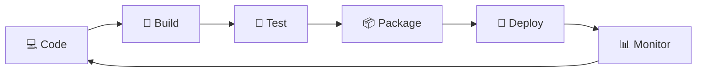

<!-- ===== HEADER BANNER (animated waves) ===== -->

  

<!-- ===== TYPING ANIMATION ===== -->

  

 

## 👨‍💻 About Me

- 👋 Hi, I'm **@V-vk-200**, a DevOps Engineer passionate about automation and reliability
- 👀 Interested in **Cloud, Kubernetes, CI/CD, IaC, AWS Services**
- 🌱 Currently learning **Jenkins CI/CD, GitHub Action, Docker, K8s.**
- 💞️ Looking to collaborate on **open-source DevOps tools and automation projects**
- 📫 Reach me: **your-email@example.com** | [LinkedIn](https://linkedin.com/in/your-profile)
- ⚡ Fun fact: *"If you do it twice, automate it."*

---

## 🛠️ Tech Stack

  

---

## 📊 GitHub Stats

  
  

  

---

## 🔭 DevOps Workflow

---

## 🤝 Connect With Me

  
  
  

